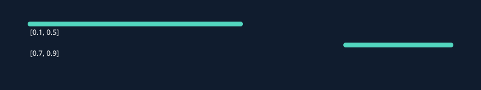

# Resultados visuais

[Início](../README.md) · [Como executar](../README.md#como-executar) · [Aprendizagem](../README.md#o-que-desenvolvi-e-aprendi) · [Estado atual](../README.md#estado-atual)

> **Nesta área:** figuras e evidências visuais; imagens ilustrativas e resultados de execução devem ser distinguidos conforme a legenda.

[Início](../README.md) · [Como executar](../README.md#como-executar) · [Aprendizagem](../README.md#o-que-desenvolvi-e-aprendi) · [Estado atual](../README.md#estado-atual)

> **Nesta área:** figuras e evidências visuais; imagens ilustrativas e resultados de execução devem ser distinguidos conforme a legenda.

Gerado por UnionOfIntervals com examples/intervalos.txt. São dois componentes, [0.1,0.5] e [0.7,0.9]. A soma em double aparece como 0.6000000000000001, exemplo de representação finita.

Reproduza com os comandos de [instalação](../docs/INSTALACAO.md).

---

**Projeto:** [MAC0122 · Algoritmos, invariantes e testes](../README.md). Consulte a raiz para os requisitos e o primeiro comando; este guia aprofunda a área `assets/`.

---

**Projeto:** [MAC0122 · Algoritmos, invariantes e testes](../README.md). Consulte a raiz para os requisitos e o primeiro comando; este guia aprofunda a área `assets/`.
