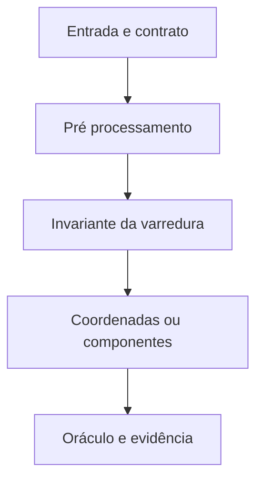

# Arquitetura e contratos

## E05 · Busca de genes

`FindGene.buscar` recebe uma sequência de A/C/G/T maiúsculos, incluindo a sequência vazia. Outros caracteres geram IllegalArgumentException. O retorno é uma lista imutável de coordenadas: início inclusivo e fim exclusivo, incluindo o stop codon.

O contrato desta edição é: ATG inicial seguido do primeiro TAA/TAG/TGA no mesmo quadro de leitura. Não há stop interno, mas pode haver outro ATG. A sequência `ATGATGATGTAA` produz três genes, iniciados nas posições 0, 3 e 6. A família `(ATG)^m TAA` produz m genes. Uma estratégia que guarda apenas o último início perderia m−1 resultados.

Uma passagem da direita para a esquerda mantém o próximo stop para cada um dos três quadros `i % 3`. Antes de registrar um stop na posição i, o algoritmo salva o stop estritamente à direita, para não confundir a própria posição com o sucessor. Uma segunda passagem consulta esse índice em O(1) por ATG.

Para sequência de tamanho n e g resultados, a busca custa O(n+g) e usa O(n+g) memória. Imprimir substrings acrescenta o número total de caracteres impressos. A análise não esconde esse custo. O oráculo de testes varre separadamente os códons depois de cada início.

## E06 · União de intervalos fechados

`Intervalo` exige extremos finitos e início ≤ fim. Intervalos de comprimento zero são válidos. A entrada não é alterada. `unir` ordena por início/fim e devolve componentes imutáveis ordenados e disjuntos.

Invariante: após cada passo, os componentes representam exatamente a união do prefixo processado. Como os inícios foram ordenados, só o último componente pode intersectar o próximo intervalo. Se o novo início supera seu fim, abre-se outro componente; caso contrário, atualiza-se o fim com o máximo. Toque em extremidade conta como interseção. Ordenação O(n log n), varredura O(n), memória O(n).

O programa aceita stdin ou arquivo, com pares de doubles separados por espaços. `-v` lista os componentes e gera SVG. Para 1–3, 2–4.5, 6–9 e 7–8, a união é [1,4.5] e [6,9]: comprimento 6.5 e **dois** componentes. Um exemplo antigo que indicava três estava inconsistente.

A aritmética usa double. Não há tolerância geométrica implícita nem garantia de exatidão decimal. Extremos finitos podem produzir uma soma infinita; a CLI rejeita esse resultado em vez de exibi-lo como comprimento válido.

## T07 · Busca em A+A

`BuscaEmAA.contar` exige vetor de int não decrescente e alvo long. Conta pares de índices i<j, não apenas pares de valores distintos. Não altera o vetor.

Com soma pequena, descartar o menor elemento é seguro: nenhum elemento restante à direita é maior que a extremidade direita atual. Com soma grande, descarta-se o maior pelo argumento simétrico. Na igualdade, blocos distintos de multiplicidades m e n contribuem m·n. Se as extremidades são iguais, todos os k valores ativos são iguais e contribuem k(k−1)/2. O intervalo ativo diminui a cada passo: O(n), memória O(1). A soma converte para long antes da operação e não sofre overflow de int.

